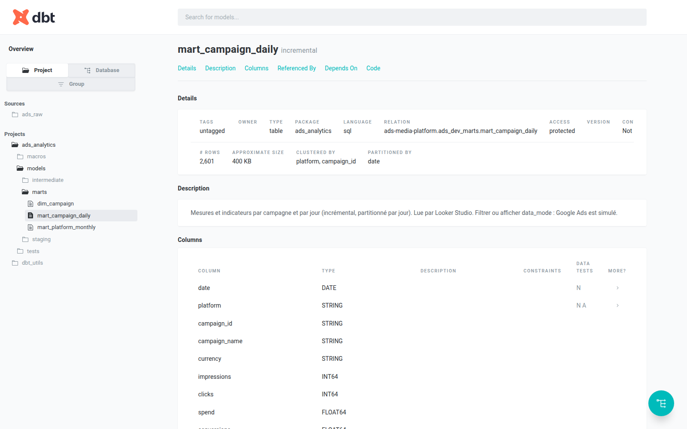
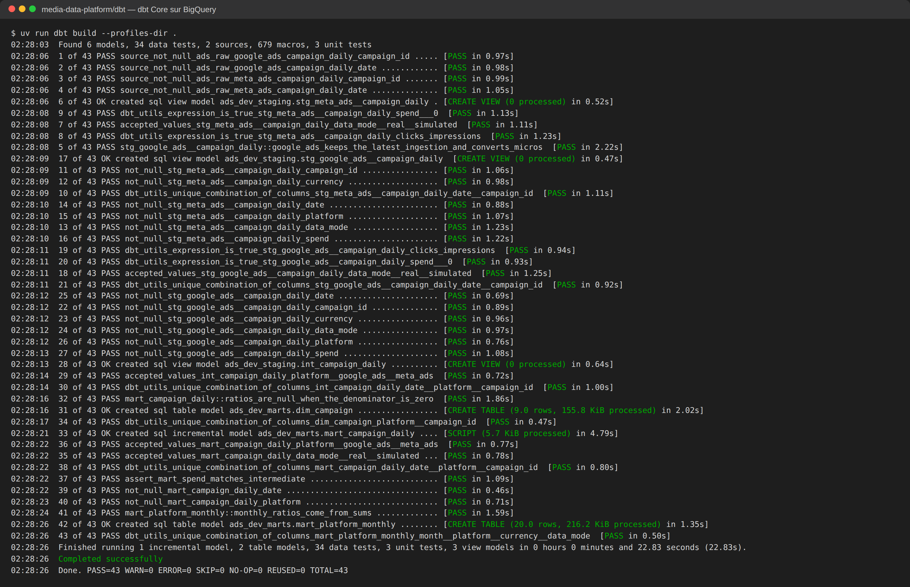
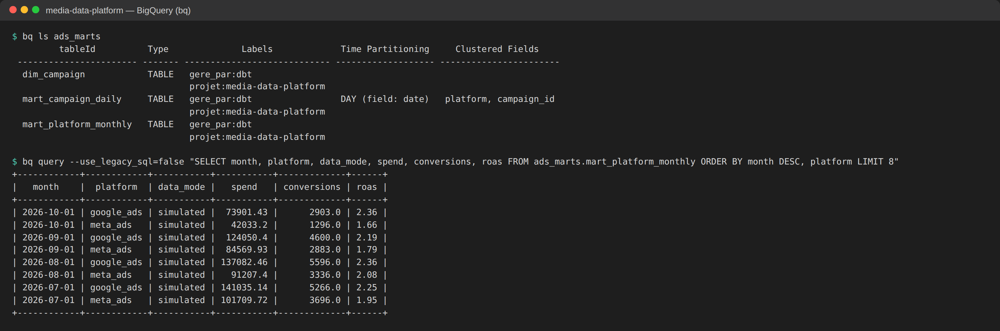
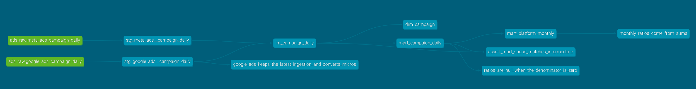

# Media Data Platform

**Pipeline ELT de données publicitaires** : les performances de Meta Ads et de Google Ads réunies dans BigQuery, transformées avec dbt en tables d'analyse fiables, avec une seule définition par indicateur.

## Problématique

Une agence marketing pilote ses campagnes sur Meta et sur Google. Chaque plateforme livre ses données dans son propre format, avec ses noms de colonnes et ses corrections tardives.

- Le même indicateur (CTR, CPC, CPA, ROAS) est calculé différemment d'un tableau de bord à l'autre.
- Comparer les deux plateformes demande un retraitement à la main.
- Relancer une extraction duplique des lignes, et gonfle les dépenses et les conversions.

## Architecture

```
Meta Ads (API réelle) ─┐
                       ├─► contrat de données ─► BigQuery ads_raw ─► dbt : staging ─► intermediate ─► marts ─► Looker Studio
Google Ads (simulé) ───┘    (lot invalide = rien n'est chargé)

Orchestration prévue : Cloud Scheduler ─► Cloud Workflows ─┬─► ingestion Meta Ads ───┐
                                                          └─► ingestion Google Ads ─┴─► dbt build
```

## Ce que j'ai construit

| Étape | Réalisation | État |
|---|---|---|
| Environnement | Python 3.14 géré par uv, versions verrouillées, ruff à chaque commit | fait |
| Ingestion | Un connecteur par plateforme, avec la même interface : ajouter une source = un fichier et un schéma | fait |
| Validation | Chaque lot est contrôlé contre un contrat de données (types, obligatoires, fenêtre, doublons, règles métier) | fait |
| Chargement | Table temporaire puis transaction `DELETE` + `INSERT` sur la fenêtre de dates : rejouer un chargement donne le même résultat | fait, vérifié sur BigQuery |
| Transformation | dbt en trois couches, grain unique (plateforme × campagne × jour), indicateurs définis une seule fois, modèle incrémental | fait, vérifié sur BigQuery |
| Tests | 129 tests Python (100 % de couverture), tests d'intégration BigQuery, 34 tests de données et 3 tests unitaires dbt | fait |
| Infrastructure | Datasets BigQuery, comptes de service à droits minimaux, registre d'images, jobs, workflow et planification décrits avec Terraform | datasets créés ; déploiement écrit, à appliquer |
| Déploiement | Image Docker, Cloud Run Jobs, Cloud Workflows, Cloud Scheduler, déploiement depuis GitHub Actions sans clé | écrit, à appliquer |
| Restitution | Tables `ads_marts` prêtes pour Looker Studio : rentabilité par campagne, comparaison Meta / Google | tables prêtes ; tableau de bord à construire |

Les données Google Ads sont simulées et étiquetées `data_mode = simulated` jusque dans les tables finales. Meta Ads se lit sur l'API réelle (`--mode real`) ; sans accès configurés, il tourne aussi en simulé, avec la même étiquette.

## Les tables produites

| Table | Contenu |
|---|---|
| `mart_campaign_daily` | Une ligne par plateforme, campagne et jour : dépenses, impressions, clics, conversions, CTR, CPC, CPA, ROAS. Incrémentale, partitionnée par jour. |
| `mart_platform_monthly` | Comparaison mensuelle Meta / Google, avec des ratios recalculés depuis les sommes |
| `dim_campaign` | Le référentiel des campagnes des deux plateformes |



## Résultats

- `dbt build` passe entièrement sur BigQuery : 43 étapes sur 43 (6 modèles, 34 tests de données, 3 tests unitaires).
- 129 tests Python, avec 100 % de couverture du code d'ingestion.

### dbt Core sur BigQuery



### Tables finales dans BigQuery



### Lignage dbt



## Ce qui rend le pipeline fiable

| Sujet | Réalisation | Où |
|---|---|---|
| Rejouable | Remplacement d'une fenêtre de dates en une transaction ; une extraction vide ne supprime rien | `src/adsdata/ingestion/loader.py` |
| Schéma stable | Schéma déclaré dans le code, vérifié à chaque chargement, jamais deviné par BigQuery | `src/adsdata/ingestion/schemas.py` |
| Données contrôlées | Contrat de données avant chargement, tests dbt après | `validation.py`, `dbt/models/**/_*.yml` |
| Corrections tardives | Ingestion des 7 derniers jours chaque matin, modèle incrémental qui retraite la même fenêtre | `--lookback-days`, `mart_campaign_daily.sql` |
| Traçabilité | `extract_run_id`, `ingested_at` et `data_mode` sur chaque ligne, jusqu'aux marts | toutes les couches |
| Indicateurs justes | Ratios à `NULL` quand le dénominateur est nul ; ratios mensuels recalculés depuis les sommes | `dbt/models/marts/` |
| Coûts maîtrisés | Tables partitionnées par jour, plafond de 1 Go par requête dbt | `dbt/profiles.yml` |
| Sans clé | Identifiants par défaut en local, comptes de service en production, fédération d'identité pour GitHub | `infra/wif.tf` |

## Stack technique

| Domaine | Outils |
|---|---|
| Langages | Python 3.14, SQL |
| Entrepôt de données | BigQuery |
| Transformation | dbt |
| Restitution | Looker Studio |
| Infrastructure | Terraform, Google Cloud |
| Exécution | Docker, Cloud Run Jobs, Cloud Workflows |
| Intégration continue | GitHub Actions |
| Qualité | ruff, sqlfluff, pytest, pre-commit |
| Gestion du projet Python | uv |

## Installation

```bash
git clone https://github.com/y-ikli/media-data-platform.git
cd media-data-platform
uv sync --all-groups --all-extras
uv run pre-commit install
cp .env.example .env              # puis renseigner GCP_PROJECT_ID
gcloud auth application-default login
```

`uv` installe Python et les bibliothèques aux versions exactes du fichier `uv.lock`.

## Utilisation

```bash
# Ingestion : une source, une période (ou les N derniers jours)
uv run adsdata-ingest --source google_ads --start 2026-01-01 --end 2026-10-16
uv run adsdata-ingest --source meta_ads --mode real --lookback-days 7
uv run adsdata-ingest --source meta_ads --lookback-days 7 --dry-run   # contrôle sans écrire

# Transformation
cd dbt
uv run --env-file ../.env dbt build --profiles-dir .                 # cible dev
uv run --env-file ../.env dbt build --profiles-dir . --target prod   # tables de production

# Qualité
uv run ruff check . && uv run mypy && uv run pytest --cov
ADSDATA_IT_PROJECT=<projet> uv run pytest -m integration           # sur BigQuery
uv run sqlfluff lint dbt/models
```

## Structure

```
src/adsdata/          ingestion : configuration, schémas, contrat de données, connecteurs, chargeur, commande
src/adsdata/simulation/  données simulées déterministes
dbt/                  staging, intermediate, marts, tests
infra/                Terraform : BigQuery, IAM, Artifact Registry, Cloud Run, Workflows, Scheduler, GitHub
tests/                tests unitaires et d'intégration
Dockerfile            une image pour l'ingestion et dbt
```

---

Auteur : Younes IKLI · [portfolio](https://y-ikli.github.io)
